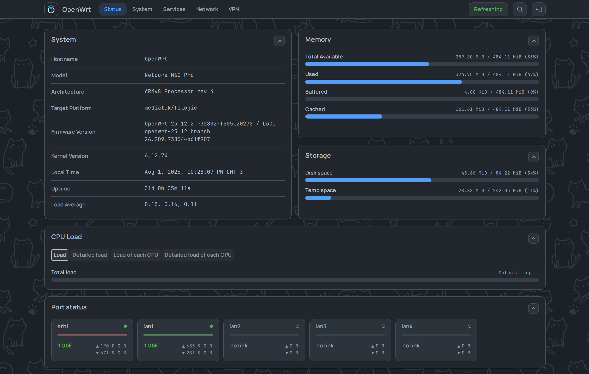

# luci-theme-footstrap

A LuCI theme for OpenWrt 24.10.3 and newer, for anyone who manages a router through LuCI.
To install it, run one command on the router: see [Install in one command](#install-in-one-command).

[Русский](README_ru.md) · [Playground: the theme in your browser, no router needed](https://vizzletf.github.io/luci-theme-footstrap/playground/)

<picture>
  <source media="(max-width: 767px)" srcset="assets/readme/phone-menu-dark.png">
  
</picture>

## What the theme does

| Feature | Detail |
|---|---|
| Dependencies | `luci-base` only |
| Coverage | Styles every LuCI page, including third-party `luci-app-*` pages |
| Apps with their own styles | Leaves alone what an app styles itself |
| Phone | Works on a phone and installs to its home screen |
| Appearance | 26 settings: layout, palette, density, colours, wallpaper, transparency. They apply without a reload. |

## Check the requirements first

| Your setup | What you get |
|---|---|
| OpenWrt 25.12 or newer (package manager `apk`) | The latest version |
| OpenWrt 24.10.3 or newer (package manager `opkg`) | The latest version |
| OpenWrt 24.10.0 to 24.10.2 | Nothing: these releases lack a LuCI widget the theme uses. Upgrade OpenWrt first. |
| OpenWrt 23.05 | Version 0.14.2, the last one that runs there. The same install command picks it. Later versions use a LuCI widget that 23.05 lacks. |

The browser must be Chrome 120, Firefox 121, Safari 17.2 or newer.

To see your OpenWrt version, run `cat /etc/openwrt_release` on the router.

## Install in one command

Step 1 runs in a terminal on the router. Steps 2 to 4 run in the LuCI web page.

1. Log in to the router over SSH as root, for example `ssh root@192.168.1.1`, and run:

   ```sh
   wget -qO- https://raw.githubusercontent.com/VizzleTF/luci-theme-footstrap/main/install.sh | sh
   ```

   The script adds the theme's package feed and verifies the package's signature and checksum. Then it installs the theme.
   It prints what it did: installed, upgraded from a named version, or already current.

   If this fails with error 429, run the copy attached to the latest release instead. GitHub sends
   429 when many users share one public IP address, as behind a provider's CGNAT.

   ```sh
   wget -qO- https://github.com/VizzleTF/luci-theme-footstrap/releases/latest/download/install.sh | sh
   ```

2. Open **System → System → Language and Style**.
3. Set **Design** to **Footstrap**.
4. Click **Save & Apply**. The page reloads in the new theme.

Later versions arrive with the router's own `apk upgrade` or `opkg upgrade`.

## Remove it with one command

Run `apk del luci-theme-footstrap`, or `opkg remove luci-theme-footstrap` on opkg.
LuCI falls back to bootstrap on its own; you do not need to change **Design** first.

## Pages paint 3.03× faster than with bootstrap

On the same router, the median page paints 3.03× faster than with the stock bootstrap theme.
A 38-page tour takes 4.9 s instead of 11.3 s.
Method and data: [docs/benchmark.md](docs/benchmark.md).

## Links

- [Screenshots](docs/screenshots/)
- [Developer documentation](docs/README.md): start with [architecture.md](docs/architecture.md) and [conventions.md](docs/conventions.md)
- [Styling a `luci-app` for any theme](docs/luci-app-styling-guide.md) and the [devkit](https://vizzletf.github.io/luci-theme-footstrap/) that checks its CSS
- [Changelog](CHANGELOG.md) · [Package feed](https://owfeed.org/install/) · [License: Apache-2.0](LICENSE)
