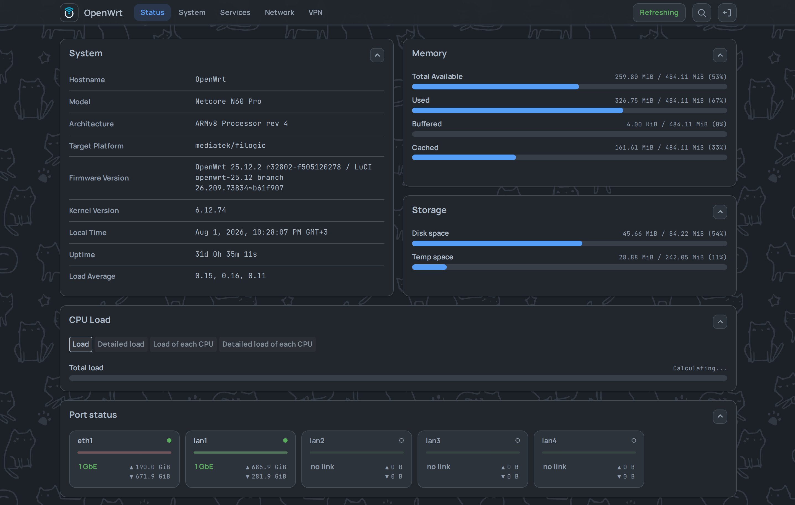

# luci-theme-footstrap

Тема LuCI для OpenWrt 24.10.3 и новее, для всех, кто управляет роутером через LuCI.
Ставится одной командой на роутере: см. [Установка одной командой](#установка-одной-командой).

[English](README.md) · [Песочница: тема в браузере, роутер не нужен](https://vizzletf.github.io/luci-theme-footstrap/playground/)

<picture>
  <source media="(max-width: 767px)" srcset="assets/readme/phone-menu-dark.png">
  
</picture>

## Что умеет тема

| Свойство | Подробности |
|---|---|
| Зависимости | Только `luci-base` |
| Охват | Оформляет каждую страницу LuCI, включая сторонние `luci-app-*` |
| Приложения со своими стилями | Не трогает то, что приложение оформляет само |
| Телефон | Работает на телефоне и ставится на его домашний экран |
| Внешний вид | 26 настроек: раскладка, палитра, плотность, цвета, обои, прозрачность. Применяются без перезагрузки страницы. |

## Сначала проверьте требования

| Ваша система | Что вы получите |
|---|---|
| OpenWrt 25.12 или новее (менеджер пакетов `apk`) | Последнюю версию |
| OpenWrt 24.10.3 или новее (менеджер пакетов `opkg`) | Последнюю версию |
| OpenWrt с 24.10.0 по 24.10.2 | Ничего: в этих релизах нет виджета LuCI, который использует тема. Сначала обновите OpenWrt. |
| OpenWrt 23.05 | Версию 0.14.2, последнюю, что там работает. Её ставит та же команда установки. Более новые версии используют виджет LuCI, которого в 23.05 нет. |

Браузер: Chrome 120, Firefox 121, Safari 17.2 или новее.

Версию OpenWrt покажет команда `cat /etc/openwrt_release` на роутере.

## Установка одной командой

Шаг 1 выполняется в терминале роутера. Шаги 2–4 — на веб-странице LuCI.

1. Зайдите на роутер по SSH под root, например `ssh root@192.168.1.1`, и выполните:

   ```sh
   wget -qO- https://raw.githubusercontent.com/VizzleTF/luci-theme-footstrap/main/install.sh | sh
   ```

   Скрипт добавляет фид пакетов темы, проверяет подпись и контрольную сумму пакета и ставит тему.
   Потом печатает, что сделал: поставил, обновил с такой-то версии или всё уже актуально.

   Если команда падает с ошибкой 429, запустите вместо неё копию, приложенную к последнему релизу.
   GitHub отвечает 429, когда много пользователей выходят в сеть с одного IP, например за CGNAT провайдера.

   ```sh
   wget -qO- https://github.com/VizzleTF/luci-theme-footstrap/releases/latest/download/install.sh | sh
   ```

Названия пунктов ниже даны для LuCI на английском, в скобках — для LuCI на русском.

2. Откройте **System → System → Language and Style** (**Система → Система → Язык и тема**).
3. Выберите **Footstrap** в поле **Design** (**Тема оформления**).
4. Нажмите **Save & Apply** (**Применить**). Страница перезагрузится в новой теме.

Новые версии дальше приходят вместе с `apk upgrade` или `opkg upgrade` роутера.

## Удаление одной командой

Выполните `apk del luci-theme-footstrap`, а на opkg: `opkg remove luci-theme-footstrap`.
LuCI сам вернётся к bootstrap; менять **Design** заранее не нужно.

## Страницы отрисовываются в 3.03 раза быстрее, чем с bootstrap

На том же роутере медианная страница отрисовывается в 3.03 раза быстрее, чем со стоковой темой bootstrap.
Обход 38 страниц занимает 4.9 с вместо 11.3 с.
Методика и данные: [docs/benchmark.md](docs/benchmark.md).

## Ссылки

- [Скриншоты](docs/screenshots/)
- [Документация для разработчика](docs/README.md), на английском: начните с [architecture.md](docs/architecture.md) и [conventions.md](docs/conventions.md)
- [Как оформить `luci-app`, чтобы он работал под любой темой](docs/luci-app-styling-guide_ru.md) и [devkit](https://vizzletf.github.io/luci-theme-footstrap/), который проверяет его CSS
- [История изменений](CHANGELOG_ru.md) · [Фид пакетов](https://owfeed.org/install/ru/) · [Лицензия: Apache-2.0](LICENSE)
