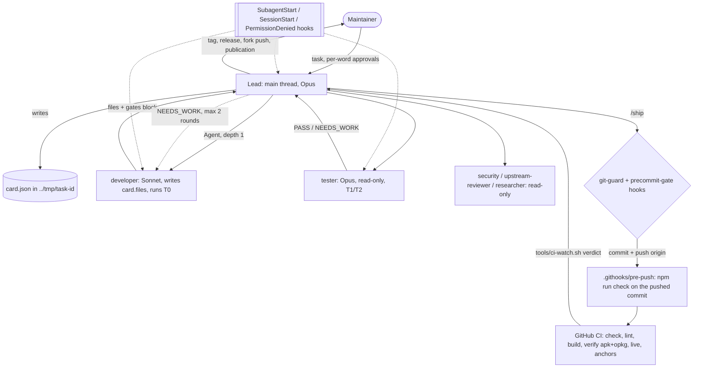

# The AI-development architecture

How Claude Code works on this repository: one lead thread that orchestrates, role subagents that
do the work, a card that holds the state, a loop that ends, and guardrail layers that hold whatever
must hold every time. For the lead and for whoever edits a role, a hook, a skill or a permission.
`CLAUDE.md` carries the always-needed rules and is the single source of the commit policy; this page
is the reference behind it. The interactive diagram is `docs/ai-architecture.html`: an archify
viewer with inline SVG, ~0.7 MB, kept at that size because the interactivity is the point. Its
source is `docs/ai-architecture.json`; edit that and regenerate with the archify skill.

The design follows one principle: the simplest workflow that works, more machinery only where a
measured failure asks for it. A solo frontend package has few parallel subtasks, and multi-agent
runs cost several times the tokens, so this is one writer at a time with read-only reviewers
beside it, not a swarm. Why delegate at all: the heaviest session on record put 484 Bash results
and 20 screenshots through one context against 5 delegations; a subagent spends tens of thousands
of tokens and returns one to two thousand.

## Overview



## Roles

| Role | Model | `maxTurns` | Writes | Sees | Returns |
|---|---|---|---|---|---|
| lead (main thread) | Opus | n/a | `docs/**` and config; stages by path, commits and pushes per `CLAUDE.md` "Commits" | the card, the return blocks | decisions, status |
| `developer` | Sonnet | 60 | inside `card.files`; the round tree in a private index | the card, its rules file, a handoff if any | files + gates block |
| `tester` | Opus | 100 | nothing | the diff and the card | verdict block |
| `security` | Sonnet | 25 | nothing | the diff | findings block |
| `upstream-reviewer` | Opus | 30 | nothing (Bash held read-only by a hook) | the luci branch diff against `origin/master` | findings block |
| `researcher` | Sonnet | 20 | nothing | the question | answer + ranked sources |

`maxTurns` is the budget one card needs. `developer` 60: a card is one mechanism, and the handoff
is written at turn 45, leaving the next developer a clean state. `tester` 100: it starts detached
runs and reads the waiter's result, so its turns are runbook steps, not wall-clock. A role that
runs out is a card to split. Code is the `developer`'s because the lead's own edits skip T0 and the
tester's diff; docs and config are the lead's because only `npm run check:fast` reads them.

One `developer` at a time: two writers on one card produce two designs for one problem. Subagents
spawn no subagents (nesting depth 1). The tester runs on a different model from the developer and
sees only the diff, never the developer's reasoning: a judge of the same model grades its own text
softer. `tester`, `security`, `researcher` and `upstream-reviewer` carry `disallowedTools: Edit,
Write, NotebookEdit`; Bash can still write, so read-only is a contract, not a sandbox: after the
tester the lead reruns `developer.md` step 2 into `../tmp/task-<id>/check.idx` over the paths
`git diff --name-only HEAD <tree>` prints, and the tree it prints equals the round's `tree`. For a
package or guard path `precommit-gate.sh` now does that at commit time (below, "The card"); the
lead's `check.idx` stays for every other path.

The lead relays each return block to the maintainer in Russian: fields, commands, paths and numbers
as printed, the prose around them translated.

## The card

The lead writes `../tmp/task-<id>/card.json` before the first delegation. JSON, because models
rewrite JSON less readily than Markdown, and a file outlives a compaction.

```json
{
  "id": "0142-appearance-note",
  "goal": "one sentence",
  "grade": "task",
  "hardware": false,
  "files": ["luci-theme-footstrap/htdocs/luci-static/resources/fs-appearance.js"],
  "rules": [".claude/rules/js.md"],
  "acceptance": [
    { "cmd": "npm run lint:js", "expect": "exit 0" },
    { "cmd": "node tools/page-modules.mjs", "expect": "exit 0" }
  ],
  "live": [{ "gate": "spa-parity", "flags": "--pages /admin/system/system" }],
  "round": 1,
  "max_rounds": 2,
  "history": []
}
```

| Field | Values |
|---|---|
| `grade` | `task`, or `release` — adds `owlab test` on both formats. Any diff touching the Makefile, `root/**`, `build-css.sh`, `tools/stage.sh` or a `strip-*` script is `release` |
| `hardware` | `false` until the maintainer says otherwise for this card |
| `round` | 1 for the first developer pass, +1 per fix round; the same number in the developer's and the tester's block |
| `history` | per tester round, the lead appends `{ "round", "tree", "verdict", "security"?, "blocking": [ids] }`, `security` being `CLEAN` when that role found no vulnerability in the tree (its LOWs go to `notes`); the commit gate reads it |

- Before its first edit or delegation the lead records what was already dirty, paths and hunks:
  `mkdir -p ../tmp/task-<id> && git status --porcelain --untracked-files=all > ../tmp/task-<id>/dirty-at-start && git diff HEAD > ../tmp/task-<id>/dirty-at-start.diff`.
  A lead-only task with no card writes the same files; `/ship` step 2 stops before staging a path
  listed there. The developer snapshots a card path listed there all the same (the tree is for
  review; the lead stages by path), and the tester leaves out every hunk `dirty-at-start.diff`
  carries. `card-gate.sh` (PreToolUse, `Agent`) holds both files: it denies a `developer` spawn
  whose prompt names no existing `../tmp/task-<id>/card.json` with `dirty-at-start` beside it, and
  prints the two commands that record it in the reason. It denies rather than asks because the
  omission is the lead's own, and every other agent type passes. Measured: 16 of 50 developer
  spawns since 2026-10-07 ran with no card (audit P1-2). A Workflow script's `agent()` is no
  `Agent` tool call and does not pass through it; a writer there names its card in the prompt all
  the same.
- `scope_ok` (the tester's): every code path `CLAUDE.md` "Crew" lists that `git status
  --porcelain --untracked-files=all` shows, less `dirty-at-start`, is in `card.files`; and
  `git diff --name-only HEAD <tree>` holds each `card.files` path `git status` shows and nothing
  outside `card.files`. Docs and config are the lead's to edit mid-task and do not count.
- **A verdict before the commit, for two classes.** `precommit-gate.sh` asks, never denies, when a
  commit carries a package path (`luci-theme-footstrap/**`, `install.sh`) or a guard path
  (`.claude/hooks/**`, `.claude/settings.json`, `.githooks/**`, `.github/workflows/**`) and no
  `../tmp/task-*/card.json` `history[]` holds a `PASS` entry that covers them: one entry covers the
  commit's package and guard paths together, by mode and blob (an exec bit or a symlink is a
  change), and says `security: "CLEAN"` when a guard path is among them. A path comes from the
  worktree under `-a`, a `git add` in the same call or `git commit <paths>`, else from the index. A
  deletion is covered by a tree that lacks the path and, in the nearest directory that survives the
  commit, holds exactly the policed files the commit leaves there: a tree from before the file
  existed lacks it too. The cards are read newest first, and the scan stops at the first entry that
  covers the whole set. What the gate cannot read (an alias, a quoted path, a flag behind a heredoc
  message) stays silent; the header of the hook lists them. Every other code path goes out on T0
  and `.githooks/pre-push` and gets its `tester` card after the push, in the same session; a
  `NEEDS_WORK` there is a fix commit.
- **A fix keeps its check.** A fix card names one check that stays in the repository, is red on
  the parent commit and holds the promise to the reader (an existing gate extended beats a new
  one), or says why there is none; the tester proves it red (`tester.md`). 9 of 28 product fixes
  since 2026-09-15 left no check behind (audit P1-14).
- One card, one mechanism; the acceptance fits in 5 lines. A card that needs more is two cards.
- A `SendMessage` to a resumed agent is a round and counts toward `max_rounds`.
- Upstream and release work splits in two: (a) base and history, verified by the `tester`; (b) the
  cut and the messages. A release card is regenerated from `git diff vX..HEAD --stat` before each
  matrix run.
- A live reproduction (stand, probe, baseline, layout question) is a `tester` card on an owlab
  stand (root, empty password).
- Steering edited mid-session (`CLAUDE.md`, measured; `.claude/rules/**` likely) reaches subagents only after a
  session restart: a subagent spawned later still reads the session-start copy (probe 2026-10-20: it
  quoted the old `## Commits` while the file on disk carried the new one). A card that depends on
  the new rule quotes it.

## Return blocks

Every role returns at most 25 lines: paths, not contents; no diff, no code, no story of the attempt.
The shape is in each role's file. The lead quotes the block; the role that produced a log reads it.
Voice, shell and waiting rules reach every role through `.claude/hooks/subagent-start.sh`
(SubagentStart), one copy for all five roles. Files a role leaves on disk are normal English prose.

## The loop

1. **Size the task.** Docs and config the lead edits itself. Code of any size goes to the crew, as
   does any task needing a gate beyond T0 or more than ~50 lines of tool output.
2. **`developer`, round 1.** Implements, runs T0, snapshots the round as a tree, returns `tree:`.
3. **`tester`.** Reads `git diff HEAD <tree>`, runs what the card asks, returns a verdict.
   `blocking` is defined once, in `.claude/agents/tester.md` "Findings"; the rest goes to `history`.
4. **Stop** when T0 is green, no finding is blocking, and the last round touched no file outside the
   previous round's set.
5. **Otherwise, one fix round.** The developer gets the blocking findings and its previous
   `not_done`; the tester gets `git diff <previous tree> <tree>` and the previous findings. Two fix
   rounds at most.
6. **At `max_rounds`** the **Recommended** option to the maintainer is "ship what PASSed, file the rest
   as an issue" or "simplify the approach"; a further round is offered last.
7. **Stall.** The same blocking id in two consecutive verdicts, or the same `tree` twice, sends
   the card to the maintainer.
8. **`security`**, once, on the final diff; skipped for CSS-only and one-line diffs. A vulnerability
   goes to the maintainer and is never auto-fixed; a functional LOW goes to card `history`.
9. **Ship.** The lead stages by path, commits and pushes through `/ship` (`CLAUDE.md` "Commits").

**The round tree.** The real index is the lead's, so a role never stages. The developer writes the
round into a private index under `../tmp/task-<id>/` and returns its tree id (the command:
`.claude/agents/developer.md` "Before returning", step 2); the lead records it in `history` with the
verdict and passes it to the next tester. Both sides of the tester's diff are trees: a diff against
the worktree goes through the real index, where a file the developer created is untracked, so it
drops this round's new file and shows last round's as deleted (scratch repo, 2026-10-19). The lead
commits with staged paths, never `-a`, and reads `git status` before staging anything.

The caps come from the evidence: iterative repair gains sit in the first two rounds, a review with
no new external signal makes the result worse, and production orchestrators stop at a stall
counter of 2–3.

## Lead conduct

- **Status:** at most 5 lines — done, running (task ids + ETA), waiting on the maintainer — sent
  on a state change, with the action already started in the same message.
- **A role returns without its block:** read `git status` and file mtimes at once and re-dispatch
  with the remaining acceptance; a finished agent sends no later notification.
- **A denied step** in a background or workflow agent: an `ask` rule denied there is re-run by the
  lead in the foreground, where the maintainer's prompt is the gate. A classifier or `deny`-rule
  denial is named to the maintainer and waits for their word on that action and target.
- **Asking:** a question opens with one plain sentence on what the thing is. A decision that a
  rule or memory already settles is taken and reported.
- **Issue replies:** one line in the maintainer's style, "fixed, ships in <next patch>", with the
  version read after `git fetch`.
- **"Not released yet":** say what reaches users from `main` now (`install.sh`) and what waits for
  the feed's next tag.
- **No-agents mode** (the maintainer asks for it on a task, e.g. «без агентов»): the lead runs the
  role's commands itself; gate output still goes to `../tmp` logs and the lead reads the tail.
- **Sessions:** one wave, one session; state lives in `card.json` (its `history`) and `docs/`, so
  an auto-compaction inside a wave loses nothing a card does not hold. At the end of a wave the
  lead writes a handoff and asks the maintainer to `/clear` (a CLI command only the maintainer
  types). A fixed token threshold was the rule until 2026-10-21 and never held: five sessions
  peaked at 304k-614k tokens (audit P1-11). A second session on the same tree works in a worktree
  under .claude/worktrees.
- **The lead reads summaries, not raw logs:** a transcript, a CI job log or a gate log longer
  than a screen goes to a read-only agent that writes `../tmp/<id>.md` and returns its path and
  verdict; `/crew-retro` fans out that way.

## Autonomy levels

`CLAUDE.md` "Commits" is the authority; this table sorts it.

| Level | Actions |
|---|---|
| Autonomous | read, plan, edit inside the role's scope; T0–T2; `owlab` stands; commit and push to `origin` `main` and own branches under the four preconditions; rebase, amend, `--force-with-lease` on own branches; the `release:` commit inside `/release`; `gh workflow run` in the theme repo (checks only, not a Pages deploy); feed publication after a tag; `ci-watch`/`ci-log` reads |
| Per word, each time | tag create/move/delete/push; `gh release *`; a Pages deploy (`-f publish-pages=true`, `pages.yml`); force-push, rebase or amend of pushed `main`; `git reset --hard` of pushed work; openwrt/luci fork pushes and upstream PR actions; every publication (comments, reviews, replies, owlab/owfeed issues); hardware router (`dev-sync.sh`, `ssh`); lowering a tier; waiving a gate |
| Never | `--no-verify` on commit or push; AI attribution trailers; staging the maintainer's own hunks; commit, push or tag from a detached run; staging or a commit by a role other than the lead |

## Guardrail layers

Instructions are advisory; hooks and permission rules are deterministic tripwires that fail open
(`.claude/hooks/git-guard.sh` header); CI is the ground truth for done. The server holds `main`
against a force-push or deletion and a `v*` tag against a move or deletion, with no bypass
(`docs/ci.md` "Rules the server holds", 2026-10-21). Accepted risk (the
maintainer, 2026-10-21): the shell Claude Code starts from exports the maintainer's secrets, signing
keys included, so every Bash subprocess, npm dependency, plugin hook and MCP server inherits them;
a `Read` deny does not cover `env`, and no layer below stops code that reads its own environment.
No OS sandbox either (the maintainer, 2026-10-21, after a measured probe): bubblewrap works on this
WSL2 host and the egress allowlist held, but daily work needs `tools/bg.sh`, every T2 gate,
`check:fast` and `owlab` excluded, and an excluded repo script can be edited and then run outside
the sandbox. Revisit when detached runs move off `tools/bg.sh`.

A guard finding counts when it is a habitual or accidental form of a per-word action or of a role
writing the checkout. A form built to dodge the hook (a line assembled at run time, a nested shell
written for it) is left to the classifier and the `ask` rules, and goes into the hook header's
list of what it does not stop instead of a patch: git-guard grew from 368 to 591 lines in two days
chasing such forms, and fixed the false prompts that growth brought (audit P1-18).

| Layer | Where | Holds |
|---|---|---|
| 1. Instructions | `CLAUDE.md`, `.claude/rules/*.md` (path-scoped), `.claude/agents/*.md`, skills, auto-memory | the policy, the tiers, the roles; the auto-mode classifier reads `CLAUDE.md` too |
| 2. Hooks | `.claude/hooks/git-guard.sh` (PreToolUse, full command: tags, releases, history rewrite, fork pushes, publications; a role's checkout, index and config writes in this checkout, denied); `precommit-gate.sh` (both CHANGELOG entries, then a recorded tester verdict on a package or guard path, and a weakened oracle: a baseline line, a raised `css-metrics` limit, a new `ALLOW` entry, fewer `test(` calls in a file, all asked); `card-gate.sh` (PreToolUse `Agent`: a `developer` spawn needs its card and `dirty-at-start`, denied); `session-start.sh` (drift from `origin/main`, a red Build push run on `main`); `.claude/hooks/subagent-start.sh` (shared role rules); `.claude/hooks/permission-denied.sh` (appends to `../tmp/denials.log` for `/crew-retro`) | the per-word list, whatever the permission mode |
| 3. Permissions and auto mode | `.claude/settings.json` `deny`/`ask`/`allow`; `autoMode` in `~/.claude/settings.json` (the classifier reads it only from user settings); `tools/bg.sh` refuses ssh, commit, push, tag and gh writes in detached runs; the MCP servers github, kubernetes, helm and Vercel are denied in this project (never called here, and their write tools bypassed every other layer) | prompts and denials before a command runs; prefix matching misses `git -C` forms, hence layer 2 |
| 4. Git hooks | `.githooks/pre-push` (`npm run check` on the pushed commit in a clean worktree), `.githooks/commit-msg` (strips trailers) | every contributor, agent or not |
| 5. CI | `build.yml`: check, lint, build, verify (25.12/apk + 24.10/opkg), live, anchors on every push; deep on a tag or dispatch | the ground truth for "done" |

**Probing a guard.** A hook or `tools/bg.sh` is tested through its decision path only: the hook
JSON on stdin (`.claude/hooks/git-guard.sh --kinds`, `precommit-gate.sh`, `card-gate.sh`) or `tools/bg.sh --check
<command>`, which print a verdict and run nothing. The guarded command itself never executes, in a
test, a probe or a stub. Real git runs in a scratch repo `git init`ed outside this checkout, with
its cwd there: `../tmp/` for a probe, the test's `mkdtemp(tmpdir())` dir for a test. The reason:
on 2026-10-19 a refusal test ran real commands through a mid-edit `bg.sh` and, in this checkout,
created a tag, reset away every uncommitted edit and set an Actions secret. For a role the rule is
held: `git-guard.sh` denies it, in this checkout, any `checkout` and `switch`, `restore`, `clean`,
`reset`, `stash`, `checkout-index`, `read-tree`, `write-tree`, `update-index`, `apply`, `pull`, `revert`,
`sparse-checkout`, `add`, `rm`, `mv`, `commit`, `merge`, `rebase`, `cherry-pick`, `am`, `bisect`,
`update-ref`, `symbolic-ref`, `reflog expire|delete|drop`, `fetch -u`, `worktree add -f|-B`, `gc --prune`,
`prune`, any `gc.*Expire` setting, a `push` into this checkout (`.`, its path or a file URL of it) or one naming
`receive.denyCurrentBranch`, `--ignore-other-worktrees`, and `branch`, `remote` and `config` writes, under any unique prefix of a
long option, and any git line that sets an alias itself (`-c`, `--config-env`, `GIT_CONFIG_*`):
whatever moves HEAD or rewrites the index, the work tree or a ref the lead works on, resolved the way it reads a push
(`cd`, `-C`, `--git-dir`, `GIT_DIR`), with the work tree judged where it resolves (`--work-tree`,
`GIT_WORK_TREE`, else the shell's directory, which a subshell, `cd -` or `popd` restores); the round
snapshot's `GIT_INDEX_FILE=` prefix (an `export` or `env` counts, a bare assignment does not) and a
scratch repo pass, `read-tree -u` never. Three
roles ran real git here on 2026-10-21, one of them `cd $R && git checkout -q -- .` with `R` lost
between two Bash calls (it reverted three tracked files): a role spells every path literally in each call.
A guard's tests run where its users stand: a clone with `origin/main` holding HEAD (the checkout's
push state) and a `git worktree add --detach` of the round (where `.githooks/pre-push` runs them, `.git`
a file there). A plain scratch copy hid both on 2026-10-22: card 0201 went red in the checkout, 0202 in pre-push.

## Skills

| Skill | Invocation | Does | Side effects |
|---|---|---|---|
| `/ship` | model | T0 check, changelog entries, commit by path, push, `ci-watch` in the background | commit and push to `origin`; never a tag |
| `/release` | model, on the maintainer's ask | pre-tag matrix, changelog rename, `release:` commit, tag, feed | asks for the tag unless the maintainer's message named it |
| `/upstream-pr` | model | openwrt/luci branch, local checks, review answers | fork pushes and replies on the maintainer's word |
| `/crew-retro` | maintainer only (`disable-model-invocation`) | reads `measure-run.mjs`, `../tmp/denials.log`, repeated corrections; sorts each into keep / skill / rule / hook / delete | edits the lead-owned rows the maintainer accepts in its "Agree" step; code goes to a card |

A procedure lives in a skill, a fact in `CLAUDE.md`, a path-scoped rule in `.claude/rules/`, a
must-always in a hook. A retro miss becomes an eval scenario for its skill before the text changes.

Evals live in `.claude/skills/<name>/evals/<case>/`: `prompt.md` and a `graders` directory, plus `case.yaml`
and `scaffold.sh` when the case needs a scaffolded repo (the release and ship cases); they run
through `claude plugin eval` as `.claude/skills/crew-retro/SKILL.md` step 8 "Agree, then apply" gives it:
paid model runs, so on the maintainer's word. The sandbox they need is `bubblewrap` and `socat`, and
`TMPDIR` must lie outside `/tmp`: the eval sandbox denies writes under `/tmp`, which covers its own
workspace there, so a case's `git fetch` fails with `Read-only file system`.

## Memory and state

- `CLAUDE.md`: at most 120 lines, facts and hard limits, pointers to `docs/`.
- Auto-memory (`~/.claude/projects/<project>/memory/`): learnings no file shows. A memory that
  recurs twice is promoted to a rule or hook and deleted; a memory keeps only the why no repo file
  carries, or it is deleted.
- `card.json`, handoffs and `tools/bg.sh` run logs in `../tmp/`: state outside any context, so a
  dead session resumes from files.

## Workflows for fan-out

A workflow script fans out independent read-only work (audits, research, per-file reviews).

- The Workflow tool keeps each script under `~/.claude/projects/<project>/<session>/workflows/scripts/`;
  one that must outlive the session is copied to `../tmp/workflows/<name>.wf.js`, and a plan or
  decision that must survive goes to `../tmp/task-<id>/`.
- Up to 16 agents in flight, the runtime's own cap (the maintainer lifted the 5-agent limit on
  2026-10-20).
- Long prompts sit in `.md` files an agent is told to read, not in template strings.
- Each agent writes a large result to a file and returns its path. The harness may refuse a
  subagent's write of a file it reads as a report; that result comes back as text and the lead
  saves it (the 2026-10-20 audit's final report).
- A gate agent (verifier, reviewer, security) that returns nothing is `not_run`, never clean: the
  script hands it back as `{not_run, error}`, a round is dry only when every gate agent answered,
  and the lead's report opens with the `not_run` list. polish-2 read four silent security rounds
  as `all_green`.
- A workflow that edits files runs "The loop": two fix rounds at most, the same blocking id twice
  (a `STILL:` repeat included) stops it for the maintainer, and after the last fix round a tester
  runs or the result is marked unverified. A verifier gets the card, the diff and the changed
  files, never the writer's reasoning (`decisions_taken`). A card split off a workflow keeps its
  `round` and `history`.
- A security agent's scope fits its 25 turns: an audit is cut by surface, and a `PARTIAL` or empty
  return is re-sent as the uncovered part, never as the same scope again.
- Writers stay one at a time in the shared checkout; parallel writers each get their own worktree
  and card, and a general-purpose workflow agent edits no repository file. On 2026-10-19 one
  writer's test ran `git reset --hard HEAD~3` in the shared tree and wiped its neighbours' work.

## Measuring the crew

```sh
node .claude/tooling/measure-run.mjs            # newest transcript of this project
node .claude/tooling/measure-run.mjs latest 3
```

The `delegated:` line counts the subagent transcripts under `<session>/subagents/`, so the lead's
number never claims work that only moved. Per card: lead tool output under 15k characters, zero
images in the lead, every gate log opened by a role, rounds ≤ 2, no stall. Baseline before the crew:
136,544 characters and 11 images in this project's largest session; the 2026-09-03 trial put 152k
characters in the lead against 1.54M across 17 subagents. On the same diff, `tester` on Opus found
three issues to Sonnet's one, which is why it runs on Opus.

After the character lines it prints the lead's characters per delegation against the 15k budget,
the lead's five largest tool outputs, and a token table per role and model, each message counted
once by `message.id`. `cache_read` is the exact cost number (audit 69c0d4f8: workflow agents 175M,
the lead 124M, tester 60M, developer 45M); a subagent's `output` is a lower bound, printed
`>=N (final/msgs final)`, because its transcript keeps the final usage line for few messages.

## Sources

- Building effective agents — https://www.anthropic.com/engineering/building-effective-agents
- Multi-agent research system — https://www.anthropic.com/engineering/multi-agent-research-system
- Effective context engineering — https://www.anthropic.com/engineering/effective-context-engineering-for-ai-agents
- Writing tools for agents — https://www.anthropic.com/engineering/writing-tools-for-agents
- Claude Code best practices — https://code.claude.com/docs/en/best-practices
- Memory — https://code.claude.com/docs/en/memory
- Subagents — https://code.claude.com/docs/en/sub-agents
- Hooks — https://code.claude.com/docs/en/hooks-guide
- Auto mode config — https://code.claude.com/docs/en/auto-mode-config
- Permission modes — https://code.claude.com/docs/en/permission-modes
- Skills — https://code.claude.com/docs/en/skills
- Skill authoring best practices — https://platform.claude.com/docs/en/agents-and-tools/agent-skills/best-practices
